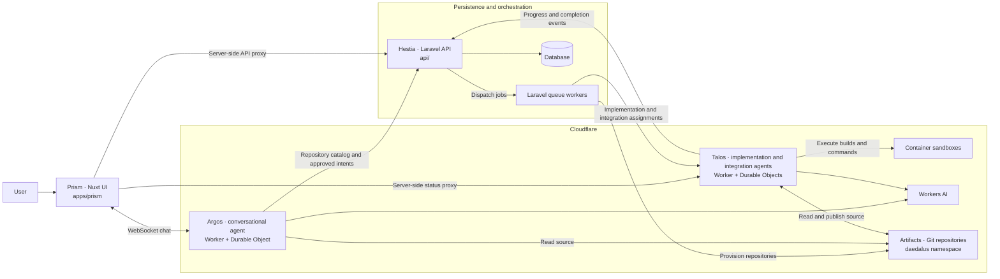

# Daedalus

Daedalus turns ideas into repository changes: refine an intent with Argos, approve it, and let Talos implement and integrate it.

## Architecture



- **Prism** is the main interface, with server-side proxies that keep service credentials out of the browser.
- **Argos** discovers and creates repositories, challenges ideas, and submits user-approved intents to Hestia.
- **Hestia** owns the repository catalog, implementation records, and queue-based orchestration.
- **Talos** implements approved intents and runs integration through a separate Integrator agent.
- Agents persist their own chat/session history in Durable Object storage; Hestia stores application records, not agent chat history.

In production, protect Prism's `/admin/*` routes and service-to-service `/internal/*` endpoints with Cloudflare Access. Localhost development does not require Access service tokens.

## Start locally

Run the following commands from the repository root.

### 1. Prerequisites

- Node.js **22.12+** and pnpm **10.34.5** (the version pinned in `package.json`).
- PHP **8.3+**, Composer, and PHP's SQLite extension.
- Git for repository initialization.
- Docker running for Talos's container sandboxes.
- A Cloudflare account with Workers AI, Artifacts, and access to the `daedalus` Artifacts namespace.

The agents use remote Workers AI and Artifacts bindings even during local development, so the full workflow requires Cloudflare credentials and network access.

### 2. Install dependencies and configure environment files

```sh
pnpm install
composer --working-dir=api setup

cp -n apps/argos/.env.example apps/argos/.env
cp -n apps/talos/.env.example apps/talos/.env
cp -n apps/prism/.env.example apps/prism/.env
```

The Composer setup script installs PHP dependencies, creates `api/.env` if missing, and generates the Laravel application key. Run it for initial setup, not to regenerate an existing application's key.

Edit `api/.env` and set:

```dotenv
CLOUDFLARE_ACCOUNT_ID=your-account-id
CLOUDFLARE_API_TOKEN=your-api-token
```

Use an API token authorized to manage Artifacts repositories and tokens in your account. The remaining example values already connect the services on localhost:

| Environment file | Service connection |
| --- | --- |
| `api/.env` | `TALOS_URL=http://localhost:5174` |
| `apps/argos/.env` | `DAEDALUS_API_URL=http://localhost:8000` |
| `apps/talos/.env` | `DAEDALUS_API_URL=http://localhost:8000` |
| `apps/prism/.env` | `NUXT_API_URL=http://localhost:8000`, `NUXT_PUBLIC_ARGOS_HOST=http://localhost:5173`, `NUXT_TALOS_URL=http://localhost:5174` |

Leave the Access credential fields empty for localhost. When connecting to Access-protected services, populate the corresponding client ID and secret fields from each `.env.example`.

Authenticate the Cloudflare CLI for both agent apps:

```sh
pnpm --filter @daedalus/argos exec cf auth login
pnpm --filter @daedalus/talos exec cf auth login
```

### 3. Initialize the database

The API defaults to SQLite. Create its database file if it does not exist, then apply migrations:

```sh
touch api/database/database.sqlite
php api/artisan migrate
```

### 4. Start the four services

Run each command in a separate terminal, from the repository root:

```sh
# Hestia: Laravel HTTP server and repository/implementation queue workers
pnpm dev:api

# Argos: conversational agent
pnpm dev:argos

# Talos: implementation and integration agents
pnpm dev:talos

# Prism: web interface
pnpm dev:prism
```

| Service | Local URL |
| --- | --- |
| Prism | http://localhost:3000 |
| Hestia | http://localhost:8000 |
| Argos | http://localhost:5173 |
| Talos | http://localhost:5174 |

Open **http://localhost:3000** to create or select a repository and start a conversation with Argos. Keep the API queue workers running: repository provisioning and approved-intent handoffs run asynchronously.
